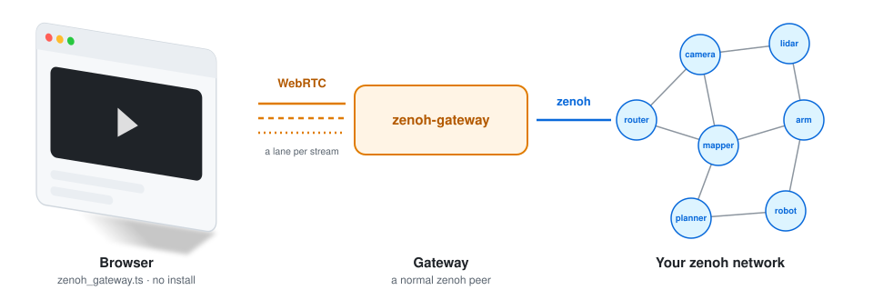

# zenoh-gateway



View and drive a [zenoh](https://zenoh.io) system from a browser, even over a weak link (a phone on bad wifi). A Rust
library serves browsers over WebRTC; a dependency-free TypeScript client talks to it. Pictures arrive as video (H.264
by default, AV1 built in, or any encoder you plug in), sound as Opus, everything else as bytes on per-stream data
channels. A per-browser bandwidth allocator decides who gets what when the link is short.

- [zenoh-gateway-cli](https://github.com/jeff-hykin/zenoh-gateway-cli): the `zenoh-gateway` command, the example page
  and the end-to-end tests.
- [zenoh-dimos-codecs](https://github.com/jeff-hykin/zenoh-dimos-codecs): ROS 2 / dimos images, depth and point clouds.
- [docs/how-to.md](docs/how-to.md): recipes (subscribe, publish, video, point clouds, ...). [SPEC.md](SPEC.md): the
  detailed contract.


## Architecture

- The gateway is a normal zenoh peer or client (zenoh 1.10.1, webrtc-rs, tokio, axum) running in your process.
  Browsers reach it with `POST /offer`, then WebRTC.
- Each subscription and publisher is its own data channel, so a slow stream never blocks another.
  `delivery: "latest"` drops old frames; `"reliable"` is ordered and lossless.
- Payloads are only parsed when a subscription picks an encoding, and only for frames that will be sent.
- Heartbeat + deadman: a publisher can leave a "stop" message on the gateway, published once if the page goes silent.

## Client API

```js
import { connect, Priority, registerEncoding } from "https://esm.sh/gh/jeff-hykin/zenoh-gateway@<commit or tag>/client/zenoh_gateway.ts"

const z = await connect("http://robot.local:7448", { heartbeatHz: 5, heartbeatMisses: 3 })
const sub = z.subscribe("camera/**", { encoding: "ros2_image", maxHz: 15 }, (msg) => {})
video.srcObject = sub.mediaStream
const cmd = z.publisher("cmd_vel", { priority: Priority.REAL_TIME, latencyLimit: 300 })
cmd.put(bytes)
await cmd.setDeadman(stopBytes)
```

Pin a commit (esm.sh transpiles on the fly), or bundle it with `deno bundle client/zenoh_gateway.ts`. An unknown option
or bad value rejects the subscription or publisher; `ready()` rejects with the reason.

### `connect(url, options)` → `Promise<ZenohGateway>`

| option | default | |
|---|---|---|
| `heartbeatHz` | 0 (off) | heartbeats per second; needed for deadmen and leases |
| `heartbeatMisses` | 3 | `misses / hz` seconds of silence = the page is gone |
| `token` | none | sent as `Authorization: Bearer` ([Auth](#auth)); a refused token rejects `connect` |
| `iceServers` | the gateway's | `RTCIceServer[]`, fetched from `GET /zenoh-gateway/ice` by default |
| `iceTransportPolicy` | the gateway's, else `"all"` | `"relay"` forces TURN |
| `reconnect` | `true` | reopen the connection and every live channel after a loss |
| `statsIntervalMs` | 1000 | how often `z.stats` / `z.gatewayStats` refresh |
| `clock` | `performance.timeOrigin + performance.now()` | the page's clock in ms |

### `ZenohGateway`

| member | |
|---|---|
| `subscribe(key, options, callback)` → `Subscription` | `msg`: `{ key, kind, bytes, encoding?, attachment?, timestamp, seq, decoded?, video?, mediaStream? }` |
| `publisher(key, options)` → `Publisher` | |
| `publishAudio(key, track, { encoding, sampleRate?, priority?, latencyLimit? })` → `AudioPublisher` | a microphone to zenoh (below) |
| `put(key, bytes, opts)`, `delete(key, opts)` | one zenoh put / delete |
| `get(key, { parameters, payload, timeoutMs = 5000, ... })`, `querier(key, opts)` | zenoh queries |
| `declareQueryable(key, { complete }, (query) => …)` | answer queries: `query.reply(...)`, `replyErr`, `replyDel`, `finalize()` |
| `declareToken(key)`, `livelinessSubscribe(key, { history }, fn)`, `livelinessGet(key)` | liveliness |
| `matchingStatus(key, "subscribers" \| "queryables")`, `matchingListener(key, target, fn)` | would anyone receive it |
| `info()` → `{ zid, routers, peers }` | the gateway's zenoh session |
| `listTopics(filter = "**", { probeMs = 0 })` → `[{ key, sources }]` | topics the gateway has seen, at once; `probeMs` listens that long first |
| `encodings` | `[{ name, output }]` the gateway runs |
| `stats`, `gatewayStats`, `pollStats()` | per-key counters and allocation; link estimate, budget, queue delay |
| `rttMs`, `clockOffsetMs`, `now()` | round trip, clock offset, the page clock |
| `state`, `onState(fn)` | `"connecting"` / `"connected"` / `"degraded"` / `"lost"` |
| `lease(group, { keys?, maxSeconds? })` → `Lease`, `expireLease(group)` | exclusive publishing ([Leases](#leases)) |
| `iceServers`, `pauseHeartbeat()`, `resumeHeartbeat()`, `close()` | |

### Subscribe options

| option | default | |
|---|---|---|
| `delivery` | `"latest"` | or `"reliable"` (not for video/audio) |
| `priority` | as published | zenoh 1–7 (`Priority.*`); ≤ 2 is strict (never degraded) |
| `maxAge` | none | ms; drop anything older |
| `maxHz` | none | never send faster |
| `bandwidthPriority` | 1 | higher keeps more when bandwidth is short; 0 gives up first |
| `minQuality` | 0 | the lowest quality the allocator may pick |
| `qualityToHzTradeoff` | 0.5 | 0 = keep quality, drop rate; 1 = keep rate, drop quality |
| `encoding` | none (raw bytes) | a name from `z.encodings` |
| `channel` | from the encoding | `"video-h264"`, `"video-vp8"`, `"video-vp9"`, `"video-av1"`, `"audio-opus"` or `"data"` |
| `encodeOptions` | `{}` | for the encoding; `quality` (0–1, default 1) is the most the allocator picks |
| `compress` | the encoding's | `"zstd"` or `"none"` (data channels); `msg.bytes` is always decompressed |
| `maxBitrate` | ~0.3 bit/pixel | video: the most bits/s it asks for |
| `minResolutionScale` | 0.25 | video: full size unless the grant is under 0.05 bit/pixel, never smaller than this share |
| `maxResolution` | none | video: `[width, height]` box the picture fits in |
| `playoutDelay` | `[0, 0]` | video: `[min, max]` ms the browser may hold a frame; `[0, 0]` shows each at once |

`Subscription`: `ready()`, `state`, `mediaStream`, `channelName`, `received`, `dropped`, `partialDropped`,
`decodeErrors`, `gatewayStats`, `rejectionReason`, `close()`, and `update(changes)`, which changes `maxHz`,
`minQuality`, `qualityToHzTradeoff`, `bandwidthPriority`, `maxBitrate`, `minResolutionScale`, `maxResolution`,
`playoutDelay` or `encodeOptions.quality` in place, with no resubscribe (`null` restores a default).

### Publisher options and methods

| option | default | |
|---|---|---|
| `delivery` | `"latest"` | `"reliable"` uses zenoh CongestionControl Block |
| `priority` | zenoh default | 1–7; ≤ 2 is sent express |
| `repeatMs` | none | re-send the last value on a timer |
| `latencyLimit` | none | ms; the gateway drops older puts |

`Publisher`: `put(bytes, { timestamp })`, `setDeadman(bytes)`, `clearDeadman()`, `state`, `onTripped(fn)`, `tripReason`,
`blocked` (why the gateway drops its puts, e.g. another client's lease), `sent`, `dropped`, `ready()`, `close()`.

**Microphone**: `publishAudio(key, track, { encoding })` sends an audio track (`getUserMedia`, which needs HTTPS or
`http://localhost`) to the gateway as Opus; the gateway decodes each packet to PCM (`sampleRate`, default 48000) and puts
the bytes its audio encoding's `encode_pcm` makes. Deadman, leases, `blocked` and `latencyLimit` (capture to arrival, clock-synced) work as above; `put` doesn't.

**Fields** messages arrive decoded in `msg.decoded`. For any other data encoding, `registerEncoding(name, decoder)`
sets `msg.decoded = decoder(msg.bytes, msg)`. Video and audio need no decoder. Also exported: `Priority` (`REAL_TIME`
1 … `BACKGROUND` 7), `decodeFrame`, `decodeFields`, `decodeVideoFrameInfo`, `encodePut`.

## Encodings and channels

A subscription names an **encoding** (how to read its messages), a **channel** to send the result on, and
**encodeOptions**. Nothing is auto-detected and the core knows no message types: the application registers encodings
(e.g. [zenoh-dimos-codecs](https://github.com/jeff-hykin/zenoh-dimos-codecs)). No encoding = raw bytes, and rate is
the only thing that degrades.

- **video** (`video-h264` default, `video-av1`, `video-vp8`, `video-vp9`): the gateway encodes pictures at the granted
  bitrate and sends them on a video track (`sub.mediaStream`). Built in: H.264 (openh264) and AV1 (rav1e, default
  feature `av1`, ~3 frames more latency). Plug in others with `ServerBuilder::video_encoder` (e.g. VideoToolbox, or
  GStreamer on a Jetson); VP8 and VP9 need one. The page refuses a channel its browser can't play.
- **audio-opus**: PCM in, Opus on an audio track.
- **data**: **fields** (built with `zenoh_gateway::Fields`, decoded by the client) or the encoding's own format
  (decoded with `registerEncoding`), optionally zstd-compressed.

## Use as a Rust library

Run the server in your process, give it your zenoh session (`zenoh_gateway::zenoh` re-exports the zenoh it uses), and
add encodings.

```toml
[dependencies]
zenoh-gateway = { git = "https://github.com/jeff-hykin/zenoh-gateway", rev = "<commit>" }
tokio = { version = "1", features = ["full"] }
```

```rust
let server = zenoh_gateway::Server::builder()
    .connect("tcp/192.168.1.2:7447")       // or .session(existing_session), or .zenoh_config(config)
    .serve_dir("ui")                       // optional static files
    .tls_files("cert.pem", "key.pem")      // optional: HTTPS
    .encoding(TextUppercase)               // a message encoding, below
    .bandwidth_target_fraction(0.75)
    .build()
    .await?;
let running = server.bind(("0.0.0.0", 7448)).await?;   // port 0 = any free port
println!("listening on {}", running.local_addr());
running.shutdown().await?;                              // deadmen fire, browsers disconnect
```

Also `server.serve(addr)`, `server.serve_with_shutdown(addr, signal)`, and `server.router()` (an axum `Router` to mount
in your own server). `GET /zenoh-gateway/health` answers `{"service": "zenoh-gateway", "version": "..."}`
(`HEALTH_PATH`). API docs: `cargo doc --open` in `gateway/`.

### Rust client (feature `client`)

Connect to a server the way a page does, e.g. to relay a robot's streams. Video and audio arrive encoded; decode them
yourself.

```rust
use zenoh_gateway::client::{Client, ClientOptions, Message, PublisherOptions, SubscribeOptions};
let client = Client::connect("http://robot.local:7448", ClientOptions { heartbeat_hz: 5.0, ..Default::default() }).await?;
let mut camera = client.subscribe("camera/front", SubscribeOptions { encoding: Some("ros2_image".into()), ..Default::default() }).await?;
while let Some(message) = camera.recv().await {
    match message {
        Message::Video(frame) => { /* frame.format, frame.data (Annex B), frame.keyframe */ }
        Message::Data(data) => { /* data.bytes, data.fields */ }
        _ => {}
    }
}
let cmd = client.publish("cmd_vel", PublisherOptions::default()).await?;
cmd.put(b"...").await?;
cmd.set_deadman(b"stop").await?;
```

Also `client.get`, `list_topics`, `lease`, `expire_lease`, `camera.request_keyframe()`, `close()` / `closed()`. A
server with no inbound ports can be reached over zenoh itself: `ServerBuilder::zenoh_signalling("robot")` and
`Client::connect_zenoh(&session, "robot", options)`
([zenoh-gateway-relay](https://github.com/jeff-hykin/zenoh-gateway-relay) uses it). See
`gateway/examples/relay_sketch.rs` and SPEC "Rust client".

### Custom encodings

Implement `zenoh_gateway::MessageEncoding`: `decode` a zenoh sample into **video** (`VideoImage::rgb8` / `::i420`),
**audio** (`AudioPcm`) or a value that `encode(frame, &EncodeOptions { quality, options })` turns into bytes. Optional:
`output_on` (other channels or options), `video_encoder` (e.g. pass through a camera's own H.264), `estimated_bytes`
(a cost model for the allocator), `default_compress`. Decodes are shared across browsers.

```rust
use zenoh_gateway::{Channel, DecodedFrame, EncodeOptions, EncodingOutput, EncodingSample, MessageEncoding};

struct TextUppercase;

impl MessageEncoding for TextUppercase {
    fn name(&self) -> &str { "text_uppercase" }
    fn output(&self) -> EncodingOutput { EncodingOutput::Data }
    fn decode(&self, sample: &EncodingSample<'_>, _channel: Channel) -> anyhow::Result<DecodedFrame> {
        Ok(DecodedFrame::data(std::str::from_utf8(sample.payload)?.to_uppercase()))
    }
    fn encode(&self, frame: &DecodedFrame, options: &EncodeOptions) -> anyhow::Result<Vec<u8>> {
        let text = frame.downcast::<String>()?;   // lower quality: a shorter prefix
        Ok(text.chars().take((text.chars().count() as f64 * options.quality).ceil() as usize).collect::<String>().into_bytes())
    }
}
```

```js
registerEncoding("text_uppercase", (bytes) => new TextDecoder().decode(bytes))
z.subscribe("chat/**", { encoding: "text_uppercase" }, (msg) => console.log(msg.decoded))
```

zenoh-gateway-cli's `examples/custom_codec.rs` is a complete program.

zenoh is pinned to 1.10.1. Leave zenoh's admin space off (`adminspace/enabled`, the default) in a config you give the
gateway: 1.7.0–1.10.1 can deadlock answering it (the gateway warns if it's on). The webrtc-rs fixes ship as renamed
crates (`zenoh-web-webrtc`, ... from [webrtc-rs-zenoh-web](https://github.com/jeff-hykin/webrtc-rs-zenoh-web)), so
dependents need no `[patch]` for them.

## Access control

zenoh's own `access_control` applies to the browsers' traffic like any other on the server's session.

## Auth

```rust
use zenoh_gateway::Grant;
let server = zenoh_gateway::Server::builder()
    .authorize(|token, _headers| match token {
        Some("viewer-token") => Ok(Grant { subscribe: vec!["robot/**".into()], list_topics: vec!["robot/**".into()], ..Default::default() }),
        Some("driver-token") => Ok(Grant { publish: vec!["robot/cmd/**".into()], lease_groups: vec!["drive".into()], max_lease_secs: Some(300.0), ..Grant::all() }),
        _ => Err("unknown token".into()),   // HTTP 401
    })
    .lease_group("drive", ["robot/cmd/**"])
    .build()
    .await?;
server.revoke("driver-token");   // closes its live connections
```

The page passes `connect(url, { token })`. A `Grant` lists allowed keys per action (`subscribe`, `publish`, `query`,
`queryable`, `liveliness`, `listTopics`, optionally `delete` and `livelinessTokens`) plus lease rights
(`leaseGroups`, `maxLeaseSecs`, `forceExpire`). Anything else is rejected with `not authorized to <action> "<key>"`
(`.on_refused` hears it). `Grant.acl` uses zenoh's ACL model instead. No hook = everyone gets `Grant::all()`. Issuing
tokens is up to the host (zenoh-gateway-cli's `--auth-file` is an example). SPEC "Auth".

## Leases

`const lease = await z.lease("drive", { maxSeconds: 60 })` lets only this page publish on the group's keys among the
gateway's clients (others' puts are dropped; `publisher.blocked` says why). It ends when the heartbeat stops,
`maxSeconds` passes, the page disconnects, `lease.release()`, or someone with `forceExpire` calls
`z.expireLease("drive")`; `lease.onLost(reason)` says which. Groups come from the server (`lease_group`) or, for names
it doesn't define, from the client (`{ keys: [...] }`), within the grant.

## ICE and TURN

`.ice_servers([...])` sets static servers (browsers fetch the same from `GET /zenoh-gateway/ice`). Minted credentials:
`.turn_secret(secret, ttl)` for coturn's `use-auth-secret`, `.ice_servers_fn(|request| async { ... })` for any
provider, or `.cloudflare_turn(CloudflareTurn::new(key_id, api_token))` (feature `cloudflare`).
`.udp_ports(50000..=50100)` keeps WebRTC sockets in one range for firewalls. SPEC "ICE and TURN".

## Heartbeat and deadman

With `heartbeatHz` set, `await publisher.setDeadman(stopBytes)` stores one message on the gateway. If beats stop for
`misses / hz` seconds, the page disconnects, or the gateway shuts down, it's published **once** and the publisher is
`"tripped"` (`onTripped(reason)`); make a new one to keep publishing. Background tabs throttle timers to ≥ 1 s, so keep
`misses / hz` well above that.

## Bandwidth allocation

Every 250 ms per browser: estimate the link (delivery rate + a delay trigger for data, GCC for video), take
`bandwidth_target_fraction` of it (capped by `max_bandwidth_bytes_per_sec`), reserve strict and reliable streams, and
split the rest by `demand / bandwidthPriority`. A stream granted a fraction r of its demand shrinks its message size by
`r^qualityToHzTradeoff` and its rate by the rest. Bulk sends are paced so strict streams don't wait behind them.
Numbers are in `z.stats`; SPEC "Bandwidth allocation".

## Nix / cross compiling

The flake builds with [crate2nix](https://github.com/nix-community/crate2nix), so each crate is built once and shared
across flakes that use `lib.crossRust`. Linux binaries cross compile from a Mac with zig, for glibc 2.35 (Ubuntu 22.04,
Jetson L4T 36), with no VM or GCC toolchain.

```sh
nix build .#zenoh-gateway-example                  # native
nix build .#zenoh-gateway-example-aarch64-linux
nix build .#zenoh-gateway-example-x86_64-linux
```

Pass `--max-jobs auto` if your nix builds one derivation at a time.

### A crate that depends on zenoh-gateway

zenoh-gateway builds against a fixed zenoh 1.10.1 (puts can be dropped after a publisher is undeclared;
eclipse-zenoh/zenoh#2832 is unreleased). `[patch]` doesn't carry over, so add it to yours:

```toml
[patch.crates-io]
zenoh = { git = "https://github.com/jeff-hykin/zenoh-vendor", tag = "zenoh-1.10.1-patch.1" }
```

```sh
nix flake init -t github:jeff-hykin/zenoh-gateway#downstream
cargo generate-lockfile && nix run github:jeff-hykin/zenoh-gateway#crate2nix -- generate
git add -A && nix build .#my-app-aarch64-linux --max-jobs auto
```

`lib.crossRustPackages { name, system, cargoNix, ... }` gives `<name>`, `<name>-aarch64-linux`, `<name>-x86_64-linux`
(see the template's `flake.nix`). Don't make the input follow another nixpkgs; shared pins are what let crates be
shared.

## Tests

```sh
cd gateway && cargo test --all-features && cargo clippy --all-features --all-targets && cargo doc --no-deps
deno task check                            # type-check the client
```

The end-to-end suites (real zenoh peer, server and headless Chrome) live in
[zenoh-gateway-cli](https://github.com/jeff-hykin/zenoh-gateway-cli).

## Known limitations

- Encodings shipped from the browser as WASM are not yet implemented.
- Topic listing knows a topic from its liveliness token, or from messages the gateway received on it (any page's
  subscription, or a `probeMs` listen). A quiet topic with neither is missing until it publishes during a probe.
- The default video encoder is software H.264: each stream costs CPU unless the server has a hardware encoder.
- Changes to certain keys, like `delivery`, `priority`, the encoding, or `encodeOptions` require a re-subscribe to take effect
